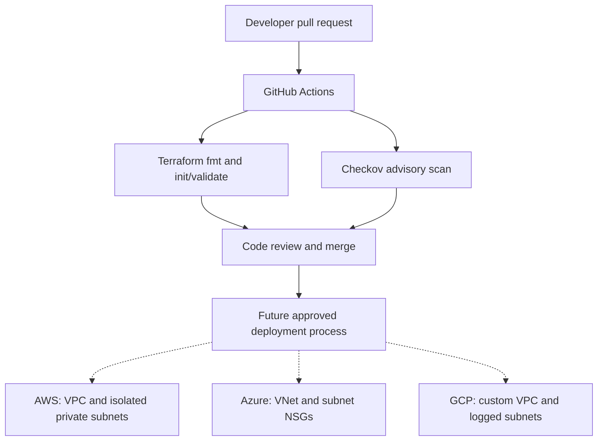

# High-level architecture — Terraform foundation

The dashed lines describe a **future** deployment workflow, not one implemented or executed here.

## Architecture decisions

1. Each cloud has independent Terraform roots to isolate providers, state, and blast radius.
2. Provider upper bounds restrict unreviewed major upgrades; lock files are created by `terraform init` and should be committed after review.
3. No cost-incurring NAT gateways, VMs, or Kubernetes clusters in this first version.
4. Validation-only CI avoids storing secrets in GitHub and does not require cloud IAM setup.
5. Azure/GCP/AWS CIDR ranges are intentionally distinct (`10.20`, `10.30`, `10.10`).
